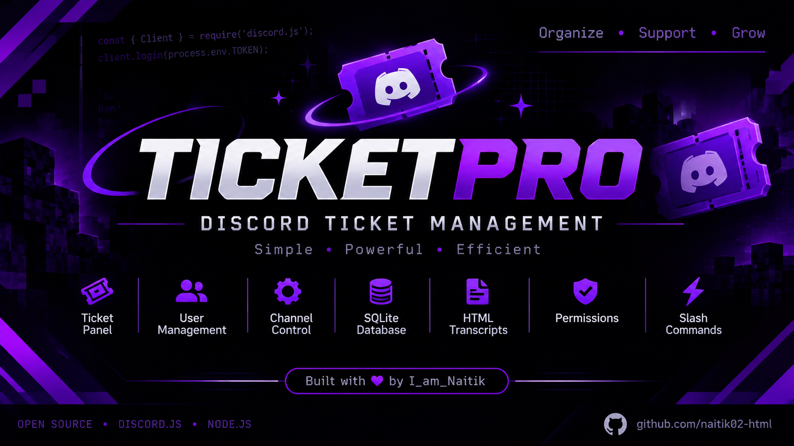

<p align="center">
  
</p>

# 🎫 TicketPro

### A Modern Discord Ticket Management System

**TicketPro** is a Discord ticket management bot built with JavaScript and Discord.js. It provides an organized support workflow with ticket controls, SQLite database storage, and HTML transcript generation.

<p align="center">
  
  
  
  
</p>

---

## ✨ Features

| Feature | Description |
|:---|:---|
| 🎫 Ticket Panel | Create an interactive ticket panel |
| 👥 User Management | Add or remove users from tickets |
| ✏️ Channel Management | Rename ticket channels |
| 🗄️ Database | Store ticket data using SQLite |
| 📄 Transcripts | Generate HTML ticket transcripts |
| 🛡️ Permissions | Manage access to ticket operations |
| ⚡ Slash Commands | Interact through Discord slash commands |

---

## 🛠️ Built With

- **JavaScript** — Application logic
- **Node.js** — Runtime environment
- **Discord.js** — Discord API integration
- **SQLite** — Persistent data storage
- **dotenv** — Environment configuration

---

## 📂 Project Structure

```text
TicketPro/
├── .env.example
├── .gitignore
├── README.md
├── add-user.js
├── config.js
├── db.js
├── deploy-commands.js
├── embeds.js
├── index.js
├── interactionCreate.js
├── logger.js
├── package.json
├── ready.js
├── remove-user.js
├── rename.js
├── ticket-panel.js
└── transcript.js
```

---

## ⚙️ Getting Started

### Requirements

- Node.js 18.17.0 or newer
- A Discord Application
- A Discord Bot Token

### Installation

**1. Clone the repository**

```bash
git clone https://github.com/naitik02-html/TicketPro.git
```

**2. Enter the project directory**

```bash
cd TicketPro
```

**3. Install dependencies**

```bash
npm install
```

**4. Configure environment variables**

Create a `.env` file using `.env.example` as your template.

Add your Discord bot credentials and required channel, category, and role IDs.

**5. Deploy slash commands**

```bash
npm run deploy
```

**6. Start the bot**

```bash
npm start
```

---

## 🤖 Available Commands

| Command | Description |
|:---|:---|
| `/ticket-panel` | Create a ticket panel |
| `/add-user` | Add a user to a ticket |
| `/remove-user` | Remove a user from a ticket |
| `/rename` | Rename a ticket channel |

---

## 🔐 Security

- Never publish your Discord bot token.
- Keep your `.env` file private.
- Never commit database files or private credentials.
- Use `.env.example` as a configuration template.

---

## 👨‍💻 Developer

**I_am_Naitik**

[GitHub Profile](https://github.com/naitik02-html)

---

<p align="center">
  <strong>TicketPro</strong>
  <br />
  Built to make Discord server support more organized.
  <br /><br />
  <sub>Developed with JavaScript & Discord.js</sub>
</p>
